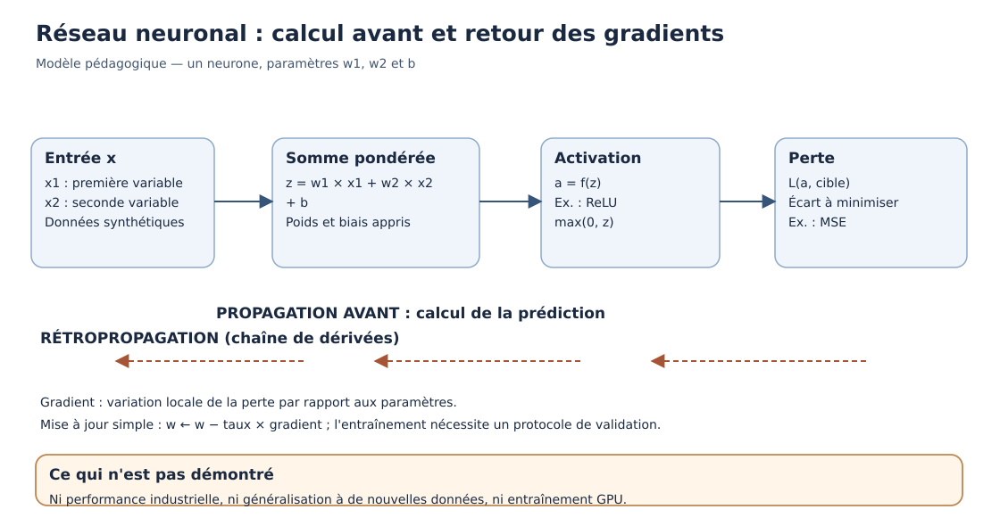

# Chapitre 05 — Deep Learning expliqué sans prérequis

> **DRAFT original, non publié.** Le chapitre présente des calculs pédagogiques, pas des benchmarks GPU.

## Objectifs

Comprendre un neurone, le rôle des poids, des couches et des fonctions d'activation, et les principes de l'optimisation. Savoir pourquoi les besoins matériels de l'entraînement diffèrent de ceux de l'inférence.

> **Rôle de ce chapitre — mécanique des réseaux.** Les poids, activations et gradients sont présentés sans GPU. Le [C06](06-language-transformers-llms.qmd) applique des représentations et des mécanismes d'attention au langage ; les mathématiques seront détaillées dans le Volume 02.

## 1. Un neurone est un calcul

Un neurone artificiel combine des entrées, des poids et un biais. Il peut ensuite appliquer une fonction d'activation :

$$
z = \sum_{j=1}^{d}w_jx_j+b, \qquad a=\phi(z).
$$

Si les entrées sont 2 et 3, les poids 1 et -1 et le biais 2, alors la valeur intermédiaire est 2-3+2 = 1. Avec la fonction ReLU, qui renvoie le maximum de zéro et de sa propre entrée, la sortie vaut 1.

Un seul neurone est limité. Plusieurs neurones peuvent former des couches successives et apprendre des représentations plus complexes.

## 2. Réseaux et transformations

Une première couche calcule par exemple une représentation intermédiaire :

$$
h=\phi(W_1x+b_1).
$$

Une deuxième couche en tire une prédiction :

$$
\widehat y=W_2h+b_2.
$$

Les tableaux de nombres ont des dimensions qu'il faut rendre compatibles. La non-linéarité est importante : des couches uniquement linéaires successives peuvent se réduire mathématiquement à une seule transformation linéaire.

## 3. Mesurer une erreur

Pour une régression, une fonction de perte élémentaire est :

$$
L=(\widehat y-y)^2.
$$

Une prédiction de 5 pour une cible de 3 produit une perte égale à 4. L'entraînement consiste à ajuster les paramètres pour réduire une perte définie sur les exemples, avec un protocole d'évaluation permettant de contrôler la généralisation.

## 4. Descente de gradient

Une étape d'optimisation peut être écrite :

$$
w_{nouveau}=w_{ancien}-\eta\frac{\partial L}{\partial w}.
$$

Le symbole eta désigne le taux d'apprentissage. Pour L(w)=(w-3)^2, la dérivée est 2(w-3). À partir de w=0 avec eta=0,1, le nouvel état vaut 0,6 et la perte tombe de 9 à 5,76.

Dans les réseaux multicouches, la rétropropagation utilise la règle de chaîne pour calculer les gradients. La descente de gradient ne garantit pas que chaque étape améliore toujours le résultat : le choix du pas et la forme de la fonction comptent.

## 5. Entraînement et inférence

L'entraînement manipule souvent des activations, gradients et états d'optimiseur en plus des poids. L'inférence applique les paramètres obtenus à de nouvelles entrées et peut utiliser d'autres caches suivant l'architecture.

Les GPU sont adaptés à de nombreux calculs parallèles, sans être obligatoires pour tous les modèles. Un système ne doit pas être dimensionné à partir du seul nombre de paramètres.

## 6. Exercices et corrigés

**A.** Calculer ReLU pour x=(1,4), w=(2,-1), b=3.

*Correction.* La combinaison vaut 2-4+3=1 ; ReLU vaut 1.

**B.** Pour L(w)=(w-2)^2, w=0 et eta=0,25, calculer une étape.

*Correction.* Le gradient initial est -4, le nouveau w vaut 1, la perte diminue de 4 à 1.

**C.** Un réseau réussit sur ses données d'entraînement et échoue sur des cas inconnus. Que faut-il examiner ?

*Correction.* La généralisation, la qualité des jeux de validation, un éventuel surapprentissage, des fuites ou un changement de population.

**D.** Faut-il obligatoirement un GPU pour démontrer l'algorithme de gradient ?

*Correction.* Non. Les exercices élémentaires peuvent être calculés à la main ou sur CPU.

*Figure originale — principe de propagation et de mise à jour. Elle ne représente pas une implémentation de réseau profond en production.*

## 7. Comprendre les formes des données : vecteurs, matrices et tenseurs

Un réseau neuronal ne manipule pas seulement des nombres isolés. Ses opérations portent sur des tableaux. Un **vecteur** est un tableau de dimension un, une **matrice** un tableau de dimension deux ; le terme **tenseur**, en informatique du Deep Learning, désigne plus généralement un tableau multidimensionnel.

Pour une entrée décrite par trois variables et une couche contenant quatre neurones, une matrice de poids peut posséder une forme \(4\times 3\). Multiplier cette matrice par un vecteur de trois éléments produit un vecteur de quatre éléments, auquel on peut ajouter un biais par neurone.

Cette règle est importante parce qu'une erreur de forme empêche souvent le calcul. Elle peut aussi révéler un problème de données : par exemple, fournir des observations dont l'ordre des variables a changé tout en conservant une taille compatible peut provoquer un **résultat faux sans erreur d'exécution**.

### Exercice de dimensions

Une couche reçoit cinq variables et produit huit activations. En ignorant d'autres mécanismes éventuels, combien contient-elle de coefficients de poids et de biais ?

**Correction.** Chaque neurone reçoit cinq poids, soit \(5\times 8=40\) poids. Il possède aussi un biais ; le total est donc **48 paramètres**.

Le nombre de paramètres ne décrit pas à lui seul la qualité de la couche. Il donne néanmoins un premier indice de volume mémoire pour les poids, avant les besoins de calcul et de stockage des activations.

## 8. Les fonctions d'activation et leurs effets

Les couches combinent des opérations linéaires et des fonctions non linéaires. Trois fonctions fréquentes sont :

| Fonction | Formule | Particularité |
|---|---|---|
| Identité | \(f(x)=x\) | Ne modifie pas la valeur |
| ReLU | \(f(x)=\max(0,x)\) | Renvoie zéro pour les valeurs négatives |
| Sigmoïde | \(f(x)=1/(1+e^{-x})\) | Valeurs strictement entre 0 et 1 |

La sigmoïde est parfois utilisée dans un calcul de score pour une classification binaire. Sa sortie n'est pas automatiquement une probabilité **bien calibrée** dans un système réel : la correspondance avec les fréquences observées doit être évaluée.

La ReLU crée une non-linéarité utile et reste simple à calculer. Elle possède toutefois une dérivée non définie au point exact zéro ; les frameworks choisissent une convention pour la différentiation automatique à cet endroit.

Les fonctions d'activation ne sont pas choisies au hasard. Leurs propriétés influencent les gradients et la stabilité de l'entraînement, sujet que le volume 06 abordera avec des exemples programmés.

## 9. Calculer une descente de gradient sans framework

Pour établir le mécanisme sans GPU, imaginons une fonction de perte d'un seul paramètre :

$
L(w)=(w-4)^2.
$

Sa dérivée est :

$
\frac{dL}{dw}=2(w-4).
$

À partir de \(w_0=0\), avec un taux d'apprentissage de 0,25 :

- au départ, \(L(0)=16\) et le gradient vaut \(-8\) ;
- première étape : \(w_1=0-0{,}25(-8)=2\), donc \(L(2)=4\) ;
- deuxième étape : le gradient vaut \(-4\), \(w_2=2-0{,}25(-4)=3\), et \(L(3)=1\) ;
- troisième étape : le gradient vaut \(-2\), \(w_3=3{,}5\), et la perte vaut \(0{,}25\).

Nous avons diminué la perte en trois opérations faciles à vérifier. Il s'agit d'un exemple **convexe et simple** ; un réseau profond peut posséder une surface de perte plus complexe.

### Ce que la rétropropagation ajoute

Dans un réseau comportant plusieurs couches, un poids de la première couche influence la prédiction de manière indirecte. Pour connaître son effet sur la perte, on applique la **règle de chaîne** : la dérivée de la composition des fonctions résulte des dérivées de chaque étape.

Sur une chaîne simplifiée \(x\rightarrow z\rightarrow y\rightarrow L\), on peut écrire :

$
\frac{dL}{dx}=
\frac{dL}{dy}
\frac{dy}{dz}
\frac{dz}{dx}.
$

Cette écriture introduit l'intuition de la rétropropagation sans demander au lecteur de maîtriser dès aujourd'hui l'algèbre matricielle et le calcul différentiel. Le volume 02 les étudiera de manière rigoureuse ; le volume 06 montrera une implémentation complète.

## 10. Itérations, mini-lots et optimisateurs

Dans une application, l'entraînement s'effectue souvent sur un ensemble d'exemples. Une **époque** (*epoch*) désigne, selon la convention du procédé, un parcours de l'ensemble d'entraînement. Un **mini-lot** (*mini-batch*) contient une partie des exemples pour une étape de calcul et de mise à jour.

Une même donnée peut contribuer à plusieurs mises à jour ; il faut donc préciser le nombre d'époques, la taille des mini-lots et l'ordre des observations pour reproduire une expérience.

La **descente de gradient stochastique (SGD)** et des optimisateurs comme **Adam** utilisent les gradients pour mettre à jour les poids, avec des règles différentes. Le volume 06 détaillera ces algorithmes et leurs états internes. Le mot « optimiseur » ne signifie pas que le procédé atteint toujours le minimum global.

### Pourquoi conserver un journal d'expérience ?

Deux entraînements peuvent varier en raison des graines aléatoires, du matériel, de l'ordre de traitement, de différences numériques ou de versions logicielles.

Pour comparer honnêtement deux modèles, enregistrer les paramètres, les données, la métrique, les versions, le matériel et les conditions d'essai. L'affirmation « la deuxième expérience est meilleure » doit pouvoir être rattachée à des mesures compatibles.

## 11. Surapprentissage, sous-apprentissage et régularisation

Le **sous-apprentissage** décrit une situation où la procédure ou le modèle ne capture pas suffisamment les relations utiles, même sur les exemples d'entraînement.

Le **surapprentissage** décrit une situation où un modèle s'adapte trop aux particularités du jeu d'entraînement et se dégrade sur des données inédites. On l'observe par exemple lorsqu'une perte d'entraînement diminue tandis que la perte de validation augmente durablement.

Il existe plusieurs stratégies pour améliorer la généralisation : collecter de meilleures données, réduire une complexité excessive, employer certaines régularisations, choisir une procédure d'arrêt, ou adapter l'objectif d'entraînement.

Aucune technique unique ne fonctionne pour tous les problèmes. Et aucun réglage ne compense une **fuite de labels** ou une mauvaise définition de la tâche.

### Exercices de diagnostic

Un modèle obtient 99 % de succès sur son entraînement et 55 % sur un test indépendant. Peut-on le déclarer prêt ?

**Correction.** Non. Il faut analyser le protocole de séparation, l'écart entre distributions, la qualité des labels, la complexité du modèle et le coût métier des erreurs.

Un petit réseau donne de mauvais résultats sur l'entraînement et sur le test. Peut-on suspecter du sous-apprentissage ?

**Correction.** Oui, mais pas uniquement. Des erreurs de normalisation, de cible ou d'optimisation peuvent aussi expliquer les résultats. Il faut formuler des hypothèses puis les tester.

## 12. Les besoins matériels ne se limitent pas aux poids

La mémoire nécessaire dépend de nombreux éléments :

1. **Poids du modèle**, à une précision numérique donnée.
2. **Gradients** et états de l'optimiseur pendant certains entraînements.
3. **Activations intermédiaires** nécessaires à la rétropropagation.
4. **Entrées, mini-lots et buffers** utilisés par les bibliothèques.
5. **Mémoire d'exécution** et caches propres au runtime et aux opérations.

Prenons un modèle hypothétique de **un million de paramètres**, stockés chacun sur 4 octets. Les poids seuls représentent environ **4 Mo décimaux**. Si l'on conserve un gradient de même taille, il faut environ 4 Mo supplémentaires, **sans compter** activations, optimiseur et autres buffers. Ce calcul didactique ne décrit pas la VRAM d'une configuration particulière.

Pour un LLM génératif, la mise en cache de certains états d'attention lors de l'inférence ajoute des besoins dépendant notamment du nombre de requêtes et de la longueur de contexte. Il serait trompeur de déduire une capacité de concurrence en lisant uniquement la taille d'un fichier de poids.

### CPU, GPU et ressources cloud

Un petit réseau peut être entraîné sur CPU. Les GPU deviennent utiles pour des charges impliquant de nombreuses opérations parallèles adaptées à leur architecture. Les différences réelles dépendent du code, des dimensions des tenseurs, des transferts mémoire et du profil de travail.

Une décision d'infrastructure ne s'appuie donc pas sur le seul prix ou la seule quantité de VRAM annoncée. Elle nécessite un protocole de mesure comparant **coût, énergie, qualité, débit, latence et contraintes d'exploitation**.

Ce raisonnement sera approfondi dans les volumes 15, 16 et 20.

## 13. La diversité des réseaux neuronaux

Tous les réseaux neuronaux ne sont pas des Transformers. Selon la tâche, différentes architectures ont été utilisées :

- les **réseaux convolutifs (CNN)** pour de nombreux problèmes de perception visuelle ;
- les **réseaux récurrents (RNN)** et variantes pour certaines séquences ;
- les **Transformers** pour le langage et de nombreuses tâches séquentielles et multimodales ;
- d'autres formes de modèles incluant des réseaux graphiques ou des architectures spécialisées.

Ces familles ont des coûts, propriétés et limites différents. L'existence de modèles polyvalents ne dispense pas d'une sélection adaptée à un problème précis.

En entreprise, un détecteur d'anomalies sur des séries de mesures, un classifieur d'images et un assistant textuel n'imposent pas nécessairement la même architecture de serving ou les mêmes métriques de qualité.

## 14. Atelier : comparer un réseau à une solution plus simple

### Scénario

Une équipe souhaite prévoir la consommation électrique horaire d'un serveur à partir de mesures historiques. Elle envisage directement un réseau neuronal profond.

**Travail demandé** : décrire une baseline, choisir un protocole temporel, définir une métrique, expliquer les conditions dans lesquelles un réseau serait justifié, puis proposer une stratégie de repli si l'inférence échoue.

### Correction indicative

**Baseline.** Une prévision simple basée sur la moyenne des heures comparables ou une méthode statistique adaptée. La pertinence dépend des régularités du système.

**Protocole.** Les données de test doivent représenter des périodes plus récentes et ne pas être utilisées pour le choix des hyperparamètres. On vérifie aussi les changements de matériel ou de politique d'énergie.

**Métrique.** Une erreur absolue ou quadratique, complétée par le coût métier des sous-estimations aux heures de pointe.

**Justification du réseau.** Amélioration mesurée et stable sur des périodes inédites, coûts d'entraînement/inférence acceptables et surveillance de dérive prévue.

**Repli.** Une procédure déterministe ou une baseline utilisable en cas d'indisponibilité du modèle, avec un mode dégradé explicite.

Le réseau n'est pas le point de départ obligatoire. Il est une **option à défendre par des preuves**.

### Autoévaluation

1. Les poids et les activations représentent-ils exactement la même information ?
2. Pourquoi l'entraînement utilise-t-il souvent davantage de mémoire que la seule conservation des poids ?
3. Que mesure le gradient ?
4. La réussite sur les exemples connus prouve-t-elle la généralisation ?
5. Un GPU est-il indispensable à l'expérience numérique du présent chapitre ?
6. Quel protocole utiliser pour comparer deux options d'infrastructure ?

**Réponses attendues.** Les poids sont des paramètres persistants ; les activations sont des résultats intermédiaires. L'entraînement conserve souvent gradients et états additionnels. Le gradient décrit une variation locale de la perte. La généralisation doit être évaluée indépendamment. Un CPU suffit au calcul didactique. Les ressources doivent être comparées à workload, qualité, charge, versions et métriques déclarés.

---

## 15. Laboratoire pratique : dérivées et descente de gradient

Le [laboratoire Python sans GPU](../../../labs/v01-gradient-descent/README.md) reprend L(w) = (w - 4)². Il compare la dérivée analytique à une différence finie centrale, puis calcule les poids et les pertes sur trois pas : (0, 16), (2, 4), (3, 1) et (3,5, 0,25).

Il va ensuite plus loin avec une régression linéaire y = wx + b sur quatre données synthétiques : x = (0, 1, 2, 3), y = (1, 3, 5, 7). Au point w = 0 et b = 0, la MSE vaut 21 et les gradients par rapport à w et b sont respectivement -17 et -8.

**Exercice corrigé.** Pour w = 2 sur L(w) = (w - 4)², le gradient vaut -4. Avec un taux d'apprentissage de 0,25, le poids suivant vaut 3. Le lecteur peut vérifier ce calcul avec le programme et comparer la dérivée analytique au gradient numérique.

Les [17 tests locaux](../../../evidence/V01_R14_GRADIENT_ATTENTION_2026-10-10.md) vérifient ces petits calculs, sans prouver un entraînement de Deep Learning industriel.

## 16. À retenir

La qualité d'un réseau dépend de sa formulation, de ses données, de son optimisation et de son évaluation. Les volumes 02, 03 et 06 étendront ces notions vers les mathématiques, Python et l'entraînement réel.

**Statut de contrôle :** figures, bibliographie primaire et laboratoire restent à enrichir avant publication. Source de contexte : [Tome 1, chapitre 4](https://drive.google.com/file/d/18TLeXZzbbtvgNSNnf_xBjP02Af1_xYl-/view).