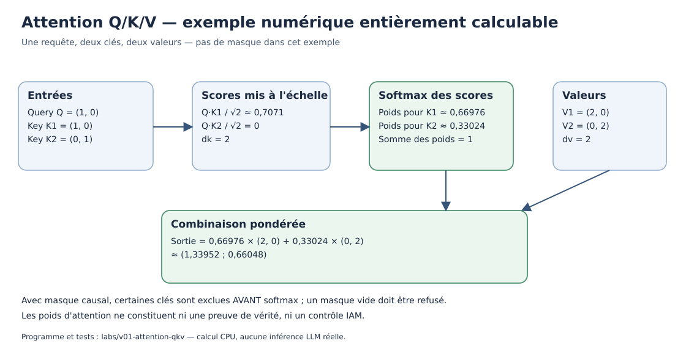

# Chapitre 06 — Premiers repères sur le NLP, les Transformers et les LLM

> **DRAFT ORIGINAL — introduction de niveau débutant, non publiée.** Ce chapitre explique l'intuition ; les démonstrations mathématiques rigoureuses et l'implémentation détaillée sont réservées aux volumes 02, 03 et 09.

## Objectifs d'apprentissage

Après lecture, le lecteur doit pouvoir expliquer pourquoi une machine convertit du texte en nombres, définir token, tokenizer, embedding, contexte et attention, distinguer pré-entraînement et inférence, calculer une petite pondération d'attention et repérer les limites d'un système de langage.

> **Rôle de ce chapitre — transformer le texte en calcul.** Tokenisation, vecteurs et attention sont présentés comme fondements, et non comme une garantie de véracité. Le [C07](07-generative-ai-multimodal.qmd) traite la production multimodale ; le [C08](08-agents-tools-autonomy.qmd) traite les outils et l'action.

## 1. Pourquoi le langage est difficile à traiter

Une même demande peut prendre plusieurs formes : « mon paiement reste en attente », « je n'ai pas reçu la confirmation » ou « je ne sais pas si l'opération est passée ». Le système doit reconnaître que ces formulations peuvent se rapporter à un problème proche, sans décider trop tôt qu'elles signifient exactement la même chose.

Le langage est ambigu. Le mot « compte » peut désigner un compte bancaire, un compte utilisateur, une opération de calcul ou un récit. Les phrases dépendent du contexte, de la langue, de l'intention et des connaissances partagées.

Le **traitement automatique du langage naturel** (*Natural Language Processing*, NLP) regroupe les méthodes utilisées pour analyser, classer, extraire, rechercher, traduire ou générer des informations textuelles. Les réseaux neuronaux modernes occupent une place importante, mais ne constituent pas la totalité des techniques NLP.

## 2. De la recherche de mots à une représentation du sens

Un système très simple peut rechercher une chaîne exacte dans un document. Cela fonctionne pour des identifiants précis et des mots-clés stables, mais ne gère pas toutes les variantes linguistiques.

Une recherche enrichie peut utiliser la **normalisation** du texte, des listes de synonymes, des modèles statistiques ou des représentations numériques. Chaque méthode apporte des compromis : les synonymes peuvent être ambigus, la normalisation peut supprimer des distinctions utiles, et une représentation dense peut rapprocher des phrases qui ne sont pas équivalentes pour une règle métier.

Dans une architecture documentaire, les identifiants exacts, dates d'effet, permissions et métadonnées restent souvent aussi importants que la proximité sémantique.

## 3. Tokens : comment le texte devient une suite exploitable

Un modèle ne reçoit pas directement des mots au sens humain. Il reçoit une représentation numérique d'unités appelées **tokens**.

Un token peut représenter un mot entier, une partie de mot, un signe de ponctuation ou une séquence d'octets, selon le *tokenizer*. Un même texte peut être découpé différemment par deux modèles.

Pour une phrase comme :

> « La banque confirme le paiement. »

un tokenizer hypothétique pourrait créer des éléments correspondant à « La », « banque », « confirme », « le », « paiement » et « . ». Un autre pourrait couper « confirme » en plusieurs morceaux. Il ne faut donc pas annoncer un nombre de tokens universel pour une phrase donnée.

### Conséquence pour les coûts et le contexte

Les API de modèles expriment fréquemment des limites ou des coûts à partir de volumes de tokens. Les tokens ne se convertissent pas en caractères ou en mots selon un ratio exact et constant : la langue, les données et le tokenizer changent la relation.

Pour dimensionner une application, il faut mesurer le profil réel des requêtes et connaître le tokenizer associé à la version du modèle.

## 4. Embeddings : représenter numériquement

Un **embedding** est un vecteur numérique qui représente un objet, par exemple un token, une phrase ou un document. Des modèles sont entraînés pour produire des représentations utiles à certaines tâches.

Il faut distinguer :

- un embedding de token utilisé à l'intérieur d'un modèle de langage ;
- un embedding de phrase ou de document utilisé pour la recherche ;
- une représentation multimodale combinant plusieurs types de données.

Deux représentations proches selon une métrique choisie peuvent indiquer des similitudes, mais ne garantissent ni identité de sens, ni vérité, ni droit d'accès. Par exemple, « compte suspendu » et « compte non suspendu » partagent beaucoup de vocabulaire tout en décrivant des états opposés.

Le volume 02 donne les outils mathématiques des vecteurs et distances. Le volume 11 présentera les choix de recherche hybride et de reranking.

## 5. Avant les Transformers : quelques idées historiques

Des systèmes plus anciens reposaient sur des règles de linguistique, des modèles probabilistes de séquences ou des architectures récurrentes. Les **réseaux récurrents (RNN)** traitaient une séquence en utilisant un état qui évolue au fil de ses éléments.

Des variantes telles que les **LSTM** ont contribué à mieux traiter certaines dépendances à travers les séquences. Elles n'ont cependant pas éliminé tous les problèmes de durée de calcul, d'information à longue distance ou d'entraînement.

Ces approches restent utiles à connaître : un modèle moderne ne signifie pas que tous les modèles anciens ont cessé d'être adaptés à certaines tâches.

## 6. L'intuition de l'attention

Dans la phrase « Le serveur a refusé la requête parce qu'il était saturé », comprendre « il » dépend du contexte. Un système doit mettre en relation plusieurs éléments, parfois éloignés dans la séquence.

Le mécanisme d'**attention** calcule des poids qui déterminent quelle importance accorder à plusieurs éléments représentés numériquement pour former une nouvelle représentation.

Les termes *Query*, *Key* et *Value* représentent trois ensembles de vecteurs :

- **Query (Q)** : ce que l'élément courant cherche ;
- **Key (K)** : ce qui permet de comparer les autres éléments ;
- **Value (V)** : l'information combinée à partir de ces éléments.

Cette explication est une analogie pédagogique. Mathématiquement, Q, K et V résultent de transformations de représentations numériques et sont appris dans le contexte du modèle.

*Figure originale — un Query, deux Keys et deux Values ; l'exemple n'applique pas de masque. Les valeurs sont indépendantes des scores calculés.*

## 7. Attention simplifiée : un calcul guidé

Le mécanisme de *scaled dot-product attention* peut s'écrire :

$$
\operatorname{Attention}(Q,K,V)
=\operatorname{softmax}\left(\frac{QK^{T}}{\sqrt{d_k}}\right)V.
$$

Nous décomposons cette expression en petites opérations accessibles :

1. un **produit scalaire** mesure la correspondance entre un vecteur Query et chaque vecteur Key ;
2. la division par la racine carrée de la dimension des clés normalise l'échelle des scores ;
3. la fonction **softmax** transforme les scores en poids positifs dont la somme est 1, dans le cas sans masque excluant tous les éléments ;
4. les valeurs V sont combinées selon ces poids.

### Mini-exemple fictif

Supposons deux clés \(k_1=(1,0)\) et \(k_2=(0,1)\), et une requête \(q=(1,0)\). Les produits scalaires sont respectivement 1 et 0. Avec une dimension des clés de 2, les scores mis à l'échelle sont \(1/\sqrt{2}\) et 0.

Après softmax, les poids sont approximativement **0,67** et **0,33**. Si les valeurs sont \(v_1=(2,0)\) et \(v_2=(0,2)\), la représentation combinée vaut environ :

$$
0{,}67(2,0)+0{,}33(0,2)=(1{,}34,0{,}66).
$$

Ce calcul illustre une pondération, non un mécanisme qui garantit la vérité ou la compréhension humaine. Dans un modèle réel, les dimensions, têtes, masques, positions et transformations sont plus nombreuses.

### Pourquoi employer plusieurs têtes ?

Dans la **multi-head attention**, plusieurs jeux de projections Q/K/V fonctionnent en parallèle pour apprendre des relations potentiellement différentes. Les résultats sont combinés par des opérations définies par l'architecture.

Le nombre de têtes ne correspond pas à un nombre de « raisonnements humains indépendants ». C'est un hyperparamètre d'architecture dont l'effet dépend du modèle et de son entraînement.

## 8. Le Transformer : un assemblage de composants

Un bloc Transformer contient généralement de l'attention et des transformations de type réseau de neurones, associées à des normalisations, connexions résiduelles et autres mécanismes suivant la variante.

Certaines architectures comportent un **encodeur**, d'autres un **décodeur**, et d'autres combinent les deux. Les modèles génératifs de texte courants s'appuient fréquemment sur des décodeurs autoregressifs, mais tous les Transformers ne suivent pas exactement cette architecture.

Les mécanismes de **position** ou d'information relative permettent de distinguer l'ordre des tokens. Sans prise en compte de l'ordre dans les composants concernés, des permutations de tokens pourraient être difficiles à distinguer.

Un **masque causal** empêche normalement un token de consulter les tokens futurs pendant l'entraînement autoregressif, conformément à l'objectif de prédiction séquentielle.

## 9. Qu'apprend un LLM ?

Un modèle autoregressif est entraîné à prédire une distribution du token suivant conditionnée par les tokens précédents. Formellement, pour une séquence de tokens \(t_1,\ldots,t_n\), la vraisemblance peut être factorisée comme :

$$
P(t_1,\ldots,t_n)=\prod_{i=1}^{n}P(t_i\mid t_1,\ldots,t_{i-1}).
$$

Il ne s'agit pas d'une garantie de vérité. Cette distribution capture des régularités du corpus et du procédé d'entraînement ; elle peut contribuer à produire un texte correct, incorrect, incomplet ou incohérent.

Le **pré-entraînement** apprend de larges représentations à partir de données. Des étapes supplémentaires peuvent ensuite adapter le modèle à certaines instructions ou préférences. La présence de connaissances apparentes dans ses poids ne prouve pas leur actualité ni leur origine exacte.

## 10. Génération : de la requête à la réponse

En inférence, un modèle reçoit une suite de tokens comprenant éventuellement des instructions, une question et des documents récupérés. Il calcule les scores possibles pour la suite, puis un procédé de décodage choisit les tokens à produire.

Des paramètres comme la température peuvent modifier le caractère plus ou moins varié de la génération. Cela ne remplace pas les contrôles de contenu, la validation des données de référence ou les tests métier.

Une requête qui semble identique à une autre peut produire une réponse différente selon le procédé d'échantillonnage, la version du modèle, son contexte ou d'autres paramètres de l'exécution.

### Contexte et limites

Un modèle dispose d'un **contexte utilisable** soumis à des contraintes d'architecture et de service. Augmenter la longueur du contexte peut accroître le calcul et la mémoire nécessaires, et n'assure pas que tous les passages seront exploités correctement.

Dans une plateforme d'entreprise, il faut vérifier la longueur **réellement disponible**, le découpage des documents et le comportement du modèle sur les requêtes longues, plutôt que se contenter d'une valeur commerciale maximale.

## 11. Serving, mémoire et KV cache : première approche

Lors de certaines inférences Transformer autoregressives, le runtime conserve des représentations de clés et valeurs calculées pour éviter de refaire certains calculs à chaque nouveau token. On parle de **KV cache**.

Ce cache peut dépendre de la taille du contexte, de la concurrence, du nombre de couches et des caractéristiques de l'architecture. Il représente une partie du dimensionnement mais pas toute la mémoire requise.

De même, le délai jusqu'au premier token (*time to first token*) et la vitesse des tokens suivants peuvent suivre des profils de calcul différents. Les volumes 15 et 16 détailleront ces notions à partir de protocoles de benchmark reproductibles.

Une machine capable de charger les poids du modèle n'est pas nécessairement capable de servir un grand nombre de requêtes simultanées avec une latence acceptable.

## 12. Une architecture d'entreprise ne se réduit pas au modèle

Dans un assistant documentaire fictif, l'utilisateur demande comment résoudre une erreur de déploiement. L'application doit vérifier son identité, rechercher la documentation qu'il peut consulter, sélectionner les passages pertinents, demander éventuellement une synthèse au LLM et vérifier les citations avant de répondre.

Pour un assistant sans droit d'écriture, ni le modèle ni les contenus documentaires ne peuvent autoriser un déploiement. Les systèmes cibles doivent refuser toute mutation non autorisée.

L'application doit aussi définir son comportement si aucun document pertinent n'est trouvé, si deux procédures se contredisent ou si le modèle ne peut pas répondre. Le silence de la base documentaire ne doit pas être transformé en procédure inventée.

## 13. Exercices progressifs

**Exercice A — Tokens.** Deux tokenizers produisent des découpages différents d'une même phrase. Quelle conséquence pour l'estimation d'un coût facturé par token ?

*Correction.* Il faut mesurer le nombre de tokens avec le tokenizer et la version correspondant au modèle réellement utilisé ; aucun ratio universel « caractères par token » ne suffit.

**Exercice B — Embeddings.** Deux documents disposent de vecteurs similaires. Peut-on affirmer qu'ils contiennent des affirmations identiques et correctes ?

*Correction.* Non. La proximité dépend du modèle d'embedding et de sa métrique. Il faut vérifier pertinence, exactitude, provenance et autorisations.

**Exercice C — Attention.** Une requête donne des poids d'attention 0,2 et 0,8 à deux valeurs \(v_1=10\) et \(v_2=5\). Quelle sortie pondérée obtient-on dans ce modèle scalaire simplifié ?

*Correction.* \(0,2\times 10+0,8\times 5=6\).

**Exercice D — Génération.** Un LLM fournit une citation vers un document qui n'existe pas. Quelle composante doit empêcher la réponse trompeuse ?

*Correction.* Une validation des références réelles à la source, effectuée par l'application ; le modèle ne prouve pas à lui seul que le document existe.

**Exercice E — Architecture.** Le LLM peut générer une commande de modification d'un cluster, mais l'application est censée être en lecture seule. Où impose-t-on la limite ?

*Correction.* Dans les permissions effectives du compte de service, les contrats API et les contrôles du service cible. La consigne du prompt complète éventuellement ces contrôles, elle ne les remplace pas.

**Exercice F — Performance.** Un modèle se charge correctement en mémoire GPU. Est-ce une preuve qu'il supportera 100 sessions concurrentes ?

*Correction.* Non. La concurrence implique aussi le KV cache, les buffers, le scheduling, le contexte des requêtes et les exigences de délai. Il faut mesurer la capacité sous charge.

## 14. Mini-cas d'architecture : diagnostic d'un dossier de paiement

Un utilisateur fictif demande : « Pourquoi mon paiement est-il encore en attente ? » Le LLM ne doit pas inventer l'état du paiement à partir de son entraînement. Le système doit consulter le **statut de référence autorisé**, récupérer éventuellement une procédure documentaire à jour, puis formuler une explication prudente.

Le contrôle de correction doit considérer séparément :

- la concordance avec le statut officiel ;
- la fidélité aux extraits de procédure et la validité des citations ;
- l'absence de divulgation de données à un utilisateur non autorisé ;
- le refus d'une action de paiement non prévue ;
- le délai de réponse et le coût mesuré sous une charge déclarée.

Cet exercice ne constitue pas une architecture de production, mais une préparation aux concepts de RAG, agents, sécurité et SI critiques.

## 15. Travaux pratiques : calculer une attention Q/K/V

Le [laboratoire Q/K/V en Python](../../../labs/v01-attention-qkv/README.md) permet de reproduire sans GPU le produit scalaire, le facteur de mise à l'échelle, le softmax stable et les masques causaux.

Pour la Query (1, 0), les Keys (1, 0) et (0, 1) et les Values (2, 0) et (0, 2), les poids attendus sont environ **0,66976** et **0,33024**. La sortie vaut environ **(1,33952 ; 0,66048)**.

L'exercice consiste à comparer les pondérations sans masque et avec une Key interdite, puis à identifier ce qui se produit si toutes les Keys sont masquées. Le programme doit refuser ce dernier cas, plutôt que produire une distribution dépourvue de signification.

Les [20 tests locaux documentés](../../../evidence/V01_R14_GRADIENT_ATTENTION_2026-10-10.md) portent uniquement sur les calculs de cet exemple, et non sur le fonctionnement d'un modèle de langage complet.

## 16. Décomposer le coût d'une requête de langage

Un assistant LLM transforme sa demande en tokens, récupère éventuellement des extraits, les ajoute au contexte puis génère des tokens de sortie. Ce processus explique pourquoi le coût ne dépend pas seulement de la longueur de la question visible de l'utilisateur.

Une requête peut contenir :

1. instructions de l'application et politique de sortie ;
2. historique nécessaire de conversation ;
3. documents récupérés et citations candidates ;
4. question courante ;
5. tokens générés pendant la réponse.

Supposons, à titre entièrement **fictif**, une requête contenant 600 tokens d'instructions, 900 tokens d'historique, 2 000 tokens de documents et 100 tokens de question, avec une réponse de 400 tokens.

Le total en entrée est \(600+900+2000+100=3600\) tokens ; la sortie en contient 400. Un service avec limites distinctes pour l'entrée et la sortie doit être dimensionné selon **ces deux quantités**, et non selon la question de 100 tokens.

Le coût monétaire dépend des tarifs du service effectivement choisi, du cache éventuel, des options du modèle et des autres postes d'infrastructure. Aucun prix n'est déduit de ces nombres fictifs.

### Le problème du contexte trop volumineux

Ajouter dix documents de plus n'est pas forcément utile. Le temps d'inférence, la mémoire et la pertinence peuvent se détériorer, et le modèle peut ignorer des passages critiques. Une bonne application de RAG choisit et vérifie les extraits nécessaires, au lieu d'utiliser la taille maximale de contexte comme stratégie unique.

Un document récupéré contient des **faits potentiels**, pas des instructions autorisées : les frontières de confiance du chapitre 08 restent pertinentes même dans une application sans outil d'écriture.

## 17. Décodage : pourquoi deux réponses peuvent différer

Après le calcul des scores des tokens, une stratégie choisit le token suivant.

### Choix le plus probable

Une méthode de décodage dite *greedy* prend, à chaque étape, l'élément de score le plus élevé après normalisation. Cette méthode peut être relativement simple, mais le choix le plus probable localement ne garantit pas que la **séquence entière** sera optimale ou factuellement exacte.

### Échantillonnage

Une autre méthode tire un token selon une distribution. Des configurations comme température et limitation à certaines probabilités ou à un nombre donné d'options modifient la diversité des sorties.

Un **exemple fictif** : les prochaines unités possibles sont A, B et C avec les probabilités \((0{,}6,0{,}3,0{,}1)\). Un choix greedy prend A. Un tirage probabiliste peut aussi retenir B ou C. Dans les deux cas, ces nombres ne disent **rien** de la vérité de l'affirmation finalement formulée.

Si une application exige une sortie structurée avec un identifiant officiel, elle doit l'obtenir d'un système de référence et valider son format. Réduire la température n'est pas un mécanisme d'autorisation ni une preuve de correction.

### Calcul illustratif

La surprise informationnelle d'un token de probabilité \(p\) peut s'écrire \(-\log p\). Avec des logarithmes naturels, un token de probabilité 0,1 produit une valeur supérieure à celle d'un token de probabilité 0,6. Ce concept aide à comprendre certains critères de modélisation, mais une faible surprise statistique **n'est pas** une garantie de qualité ou de factualité.

### Exercices corrigés

**A.** La question utilisateur compte 100 tokens et les documents ajoutés en comptent 2 000. Peut-on facturer ou dimensionner uniquement les 100 tokens ? **Non** : il faut considérer la totalité du contexte et de la sortie selon le contrat du service.

**B.** Une génération déterministe d'un texte faux est-elle préférable à une génération variable d'un texte vrai ? **Pas sur la seule déterminisme.** Il faut définir un critère de correction et évaluer les deux approches.

**C.** Un modèle renvoie un ticket inexistant avec une confiance de formulation très élevée. Quel contrôle manque ? **Une vérification de l'identifiant et du statut auprès de l'API officielle**, ainsi que l'abstention si la source fait défaut.

## 18. Les positions : pourquoi l'ordre des mots change le sens

Un modèle qui ne recevrait qu'une liste non ordonnée de mots pourrait confondre des phrases contenant les mêmes éléments dans des ordres différents. Ainsi, « le chien mord l'homme » et « l'homme mord le chien » n'attribuent pas le même rôle aux sujets et objets.

Les Transformers manipulent des représentations numériques ; les mécanismes de position servent à apporter une information sur l'ordre ou les distances entre éléments. Il existe plusieurs familles de mécanismes positionnels : absolus, relatifs et autres variantes selon l'architecture.

Le choix d'un encodage de position n'est pas une garantie de compréhension grammaticale. Il définit une information accessible au modèle, que l'entraînement doit encore exploiter correctement.

### Attention bidirectionnelle et masque causal

Dans certaines architectures, une position peut considérer d'autres positions situées avant et après elle. Pour un générateur **autorégressif**, en revanche, une position ne doit pas utiliser des tokens futurs lors du calcul de l'étape concernée.

Le masque causal sur une séquence de trois positions peut s'écrire :

| Query | Key 1 | Key 2 | Key 3 |
|---|---|---|---|
| Position 1 | Autorisé | Interdit | Interdit |
| Position 2 | Autorisé | Autorisé | Interdit |
| Position 3 | Autorisé | Autorisé | Autorisé |

Ce tableau décrit un **masque de calcul**, pas une politique d'accès à des documents. Il ne faut jamais en déduire que des permissions de sécurité sont appliquées : un mécanisme d'attention peut être causal tout en traitant un contenu que l'utilisateur n'était pas autorisé à consulter.

### Exemple de poids valides sous masque

Supposons, à titre illustratif, une matrice de poids obtenue après application du masque :

\[
A=
\begin{bmatrix}
1 & 0 & 0\\
0{,}4 & 0{,}6 & 0\\
0{,}2 & 0{,}3 & 0{,}5
\end{bmatrix}.
\]

Chaque ligne somme à un. Les éléments futurs sont nuls. Ces valeurs ont été choisies pour l'explication et ne représentent pas l'inférence d'un modèle entraîné.

**Exercice corrigé.** Une matrice comporte un poids non nul à la colonne 3 de la ligne 1. Respecte-t-elle le masque causal défini ci-dessus ? **Non.** La première position ne doit pas accéder à une Key future.

## 19. Comprendre la croissance des ressources avec la longueur

Dans l'attention dense élémentaire, comparer chacune des \(n\) Queries à \(n\) Keys produit \(n^2\) scores **par tête**, avant prise en compte d'autres opérations.

Pour \(n=2000\), la matrice contient \(4\,000\,000\) scores ; pour \(n=4000\), elle en contient \(16\,000\,000\), soit quatre fois plus.

Cela ne permet **pas** de conclure que tout modèle coûtera systématiquement quatre fois plus cher : les implémentations, optimisations mémoire, techniques d'attention, matériel et stratégies d'inférence sont différents. Le produit \(n^2\) décrit seulement la taille de cette matrice conceptuelle dense.

Pour une matrice de quatre millions de nombres stockés sur quatre octets chacun, l'espace brut des scores serait de seize millions d'octets, soit environ 15,3 MiB. Ce nombre ne comprend ni les autres tenseurs, ni les couches, ni les têtes supplémentaires, ni le cache, ni la mémoire des poids.

### KV cache et génération progressive

Lors de certaines générations autorégressives, les Keys et Values des positions déjà calculées peuvent être conservées pour éviter des recalculs inutiles. Ce **cache** consomme cependant de la mémoire, notamment lorsque plusieurs requêtes sont servies simultanément.

Le dimensionnement d'une plateforme ne peut donc pas se limiter au nombre de paramètres du modèle : longueur des contextes, concurrence, précision numérique, nombre de couches, cache et politique de génération ont aussi une importance.

**Exercice corrigé.** Deux groupes d'utilisateurs disposent du même modèle mais de limites de contexte respectives de 2 000 et 4 000 tokens. Peut-on conclure que la consommation mémoire totale double ? **Non.** La matrice dense des scores, si elle est matérialisée et comparable, croît ici par un facteur quatre, tandis que les autres postes de mémoire peuvent avoir d'autres lois de croissance ; il faut mesurer le système réel.

## 20. Synthèse et lectures de référence

**À retenir :** les mots deviennent des tokens ; les tokens sont transformés en représentations numériques ; l'attention combine des informations selon des poids appris ; un Transformer organise plusieurs de ces calculs ; un modèle de langage apprend des régularités statistiquement utiles, sans garantir la vérité de chaque sortie.

**Références de travail :**

- Vaswani et al., [*Attention Is All You Need*](https://arxiv.org/abs/1706.03762), 2017 — article de recherche initial, et non validation de notre système.
- Vaswani et al. étudient notamment des tâches de traduction dans un cadre expérimental défini : leur article ne garantit ni la vérité d'un modèle de langage ultérieur, ni sa sécurité, ni son empreinte énergétique. Les calculs simplifiés de ce cours restent des exemples originaux.
- [NIST AI Risk Management Framework](https://www.nist.gov/itl/ai-risk-management-framework) — cadre de gestion des risques pour les systèmes IA ; détails étudiés au volume 19.

