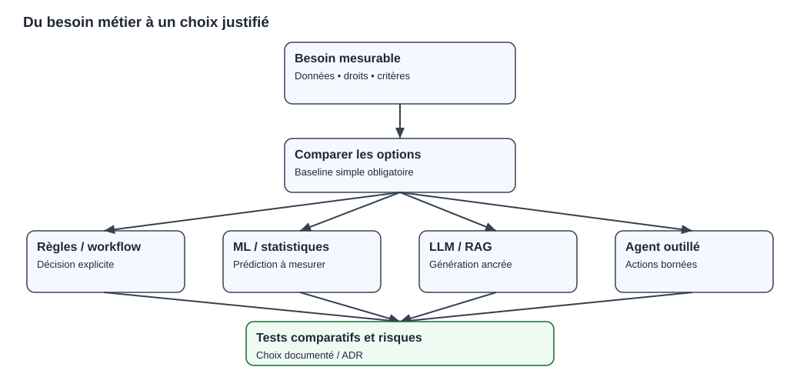

# Chapitre 09 — Panorama des cas d'usage et alternatives sans IA

> **DRAFT — exemples fictifs.** Les scores, coûts et scénarios proposés ne sont pas des mesures de projets clients, mais des exercices de décision.

## Ce que ce chapitre apporte

Identifier le besoin réel d'une application, déterminer quand l'IA n'est pas nécessaire, comparer des options avec les mêmes critères et rédiger une première décision d'architecture (ADR) justifiable devant un comité.

> **Rôle de ce chapitre — décider avant de déployer.** Le [C01](01-what-is-ai.qmd) définit les concepts ; ici, on compare les options et les alternatives sans IA. Le [C11](11-first-measurable-experiment.qmd) montre comment produire les mesures nécessaires, puis le [C12](12-capstone-and-exercises.qmd) transforme le choix en dossier.

## 1. Le point de départ : quelle décision veut-on améliorer ?

Une organisation présente parfois une solution avant d'avoir identifié le problème : « Nous voulons un chatbot IA », « il nous faut des agents autonomes » ou « le service doit utiliser un modèle open source ».

Une analyse de besoin commence plutôt par l'observation du travail actuel :

- qui accomplit la tâche et à quelle fréquence ?
- où se trouve la difficulté : recherche d'information, volume, erreur, délai, qualité ?
- quel système dispose de l'information officielle ?
- quel résultat une amélioration doit-elle produire ?
- quelles conséquences une réponse fausse ou une action non autorisée aurait-elle ?

Une décision n'est pas « intelligente » parce qu'elle utilise un modèle. Sa valeur dépend des résultats obtenus sous des contraintes réalistes.

## 2. L'échelle des solutions possibles

Avant d'introduire un LLM, envisager plusieurs familles :

| Famille | Exemple | Quand elle peut suffire |
|---|---|---|
| Formation ou correction du processus | Clarifier les règles d'un métier | L'erreur vient surtout d'une procédure ambiguë |
| Requête et moteur de recherche | Filtrer des documents par date et statut | Les sources sont bien structurées |
| Règles et moteur décisionnel | Valider un barème ou une permission | Le résultat est explicitement déterminé |
| RPA ou workflow | Recopier et contrôler des éléments | Étapes répétitives et contrats stables |
| Statistique descriptive | Suivre un indicateur et des seuils | Le passé suffit à détecter un écart simple |
| Machine Learning | Prédire une demande ou une classe | Exemples disponibles et gain validé |
| RAG / LLM | Répondre sur des documents autorisés | Un langage naturel apporte une valeur mesurée |
| Agent outillé | Sélectionner des étapes et outils | Les variations justifient ce risque et ce coût |

Cette liste ne représente pas une progression obligatoire. Plusieurs approches peuvent coexister.

## 3. Cas d'usage : opérations bancaires

### A. Expliquer le statut d'un paiement

**Besoin** : un opérateur veut comprendre pourquoi une opération reste en attente.

**Données d'autorité** : événements, accusés de réception et état officiel de transaction.

**Baseline** : consultation structurée et affichage d'un diagnostic construit à partir de règles.

**Option IA** : synthèse générative des événements accessibles et des procédures en vigueur.

**Risque critique** : annoncer qu'un paiement est définitivement exécuté alors que le système officiel ne le confirme pas.

La valeur du LLM serait l'amélioration de lisibilité ou de vitesse de diagnostic, pas la création d'une nouvelle source de vérité. L'agent ne doit pas posséder automatiquement un droit de transfert ou de relance.

### B. Détection de transactions atypiques

Une plateforme peut surveiller des événements selon des règles explicites et des modèles de Machine Learning. Les anomalies sont des **candidats à examen**, pas nécessairement des fraudes prouvées.

Une baseline de règles permet d'établir un coût des faux positifs ; un ML candidat est comparé sur un échantillon représentatif, avec des labels contrôlés, une séparation temporelle et des contraintes de gouvernance.

### C. Assistance à la rédaction d'un compte rendu

Un responsable métier souhaite produire une synthèse d'incident. Une application peut aider à organiser des éléments vérifiés, mais les participants et l'heure exacte des événements doivent provenir d'un journal autorisé. Une validation humaine peut rester nécessaire avant diffusion.

## 4. Cas d'usage : assurance

### A. Extraction de données d'un document

Le besoin est de repérer une date, un contrat et une somme. Un pipeline d'OCR, des règles de validation et un formulaire contrôlé constituent une baseline. Une méthode multimodale peut apporter un gain sur les documents variés, à condition de mesurer erreurs et cas difficiles.

Une extraction d'un montant erroné peut avoir des conséquences importantes. Il faut donc disposer d'une stratégie d'abstention et d'un circuit de correction.

### B. Aide au gestionnaire de sinistre

L'application peut retrouver des passages de conditions contractuelles et préparer une réponse. Elle ne doit pas remplacer automatiquement la décision réglementée du gestionnaire sans cadre approprié.

La séparation entre **règle de décision**, **source contractuelle**, **suggestion générative** et **autorisation de sortie** est essentielle.

## 5. Cas d'usage : industrie, énergie et maintenance

### A. Maintenance préventive

Une centrale fictive mesure vibrations et températures. On peut commencer par des alarmes de seuil et un tableau de bord. Un modèle prédictif est justifié seulement si des historiques adaptés permettent une réduction mesurable des pannes et si la performance tient dans les conditions d'exploitation.

La précision seule ne suffit pas : une intervention inutile a un coût, mais une panne non détectée peut présenter un risque beaucoup plus élevé.

### B. Prévision de consommation

Une courbe de consommation peut être anticipée par une moyenne saisonnière, une régression, un modèle de séries temporelles ou des réseaux neuronaux. La validation doit respecter la chronologie et les changements d'équipements.

Un modèle plus lourd doit apporter un gain suffisant pour couvrir son entraînement, son inférence et sa maintenance.

## 6. Cas d'usage : RH, juridique et knowledge management

Dans une base documentaire, les questions courantes peuvent souvent être résolues par une recherche efficace et des procédures lisibles. L'IA générative peut aider lorsque la demande nécessite une synthèse de plusieurs documents.

Mais les limites doivent être explicites : politique d'accès, confidentialité, protection des données personnelles, éventuelles obligations de transparence et gestion des réponses incertaines.

Pour les processus de sélection ou d'évaluation de personnes, une analyse de risques et du cadre applicable est indispensable. On ne doit pas employer un score opaque comme substitut à une décision fondée et gouvernée.

## 7. Concevoir des critères d'acceptation

Pour comparer des solutions, écrire une phrase comme :

> « Sur un corpus de 100 requêtes synthétiques préparées par le métier, la solution doit retrouver le bon statut dans tous les cas critiques, refuser toute consultation hors permission et respecter une limite de coût définie. »

Ceci reste un exemple à personnaliser. Les seuils ne sont pas choisis arbitrairement pour masquer les risques ; ils doivent correspondre aux conséquences du métier.

Un contrat d'évaluation peut inclure :

| Dimension | Question concrète |
|---|---|
| Fonctionnalité | Quel résultat vérifiable est attendu ? |
| Qualité | Quelle erreur est acceptable selon le cas ? |
| Contrôle | Quels refus doivent être systématiques ? |
| Latence | Quel délai à quelle charge ? |
| Coût | Quel budget par demande ou par période ? |
| Résilience | Que faire lorsque le modèle ou la base tombe ? |
| Énergie | Quelles ressources et quelles mesures comparer ? |

*Figure pédagogique originale : ces familles ne sont pas exclusives ; elles sont évaluées selon le besoin et les risques.*

## 8. Comparer des options avec une grille multicritère

Exemple fictif d'aide documentaire :

- **Option A** : moteur de recherche et filtres ;
- **Option B** : recherche hybride et résumé génératif ;
- **Option C** : agent qui consulte plusieurs sources et ouvre des tickets.

Pour chaque option, mesurer les **mêmes tâches** et la **même population d'utilisateurs**. Une évaluation qui attribue à C des tâches plus simples qu'à A serait trompeuse.

Les critères de sécurité essentiels peuvent être **éliminatoires** : une solution qui divulgue des documents hors périmètre n'est pas sauvée par un excellent score de qualité moyenne.

### Exemple de notation explicite, non observée

Supposons une grille de décision théorique qui pondère les critères : utilité métier 30 %, fidélité 25 %, coût 15 %, latence 15 %, exploitabilité 15 %. Chaque critère reçoit un score de 0 à 5. Un score composite pourrait être calculé ainsi :

$$
S=0{,}30U+0{,}25F+0{,}15C+0{,}15L+0{,}15E.
$$

Cette formule aide à documenter l'arbitrage, mais **elle n'est pas une certification d'architecture**. Les poids doivent être approuvés par les parties prenantes, et tout critère éliminatoire doit être traité hors du score.

## 9. Rédiger un premier ADR

Un *Architecture Decision Record* décrit une décision précise, ses options et ses conséquences.

### ADR pédagogique — Choix d'une recherche documentaire

**Contexte.** Des techniciens veulent trouver rapidement des procédures versionnées, dont certaines nécessitent une autorisation.

**Décision proposée.** Déployer d'abord une recherche traditionnelle filtrée par droits, puis mesurer les besoins résiduels. Si la synthèse libre apporte une valeur mesurée, étudier un RAG contrôlé.

**Alternatives considérées.** Recherche simple, RAG et agent outillé.

**Justification.** Éviter une dépendance à un modèle sans preuve d'amélioration et réduire le nombre de chemins d'action.

**Conséquences.** La qualité de l'indexation et des métadonnées devient prioritaire ; un modèle peut être ajouté ultérieurement sans modifier la source officielle.

**Réversibilité.** Les requêtes et les documents conservent des contrats indépendants du modèle.

Cet ADR n'est pas le résultat d'une étude réalisée pour un client. Il sert à exercer la méthode.

## 10. Exercice : choisir de ne pas utiliser d'IA

Une application vérifie qu'un identifiant existe, que l'utilisateur possède un rôle autorisé et qu'une échéance contractuelle n'est pas dépassée.

**Travail :** proposer une solution minimale et indiquer ce qu'un LLM améliorerait réellement.

**Correction.** Une validation déterministe avec autorisation côté API répond aux exigences. Un LLM pourrait aider à expliquer le résultat, mais il ne doit ni définir ni outrepasser les trois contrôles.

La possibilité de **rejeter une architecture IA** constitue une compétence de solution architect : elle évite d'ajouter coûts, surfaces d'attaque et dépendances inutiles.

## 11. Exercice : faire une expérimentation loyale

Une équipe affirme que son nouvel agent réduit de moitié le temps de résolution des tickets. Elle a cependant testé l'agent sur des tickets simples et la baseline sur des incidents complexes.

**Correction.** La comparaison n'est pas loyale. Il faut définir des populations de tâches comparables, les conditions de mesure, le nombre d'échantillons, les critères de résolution et le traitement des abandons. Le temps de rédaction de la réponse n'est pas nécessairement le temps de résolution réelle du ticket.

## 12. Exercice : architecture de valeur et sobriété

Un modèle plus lourd diminue une erreur moyenne de façon marginale, mais exige une infrastructure énergétique et financière bien plus importante.

**Correction.** Comparer la **valeur métier du gain**, son incertitude, les risques, le coût total, les émissions selon un périmètre défini et les alternatives d'optimisation du modèle plus petit. La sobriété ne se réduit pas à choisir la plus faible consommation brute si les résultats ne sont pas équivalents.

## 13. Atelier supplémentaire — critères éliminatoires avant notation

Une matrice multicritère ne doit pas autoriser une application à compenser une fuite de données par un bon score de coût ou de facilité d'utilisation.

### Deux temps pour décider

**Premier temps : admissibilité.** Vérifier l'authentification, les droits documentaires, l'absence d'outils interdits et la gestion des questions sans réponse. Une option qui viole un critère essentiel n'entre pas dans la comparaison finale.

**Deuxième temps : comparaison loyale.** Pour les options restantes, mesurer sur les mêmes tâches la qualité, le coût, la latence et les coûts d'exploitation. Ne pas confondre une description d'architecture et un résultat d'essai.

| Question | Recherche simple A | RAG B | Agent C |
|---|---|---|---|
| ACL démontrées ? | Pas encore | Pas encore | Pas encore |
| Source de réponse identifiée ? | Prévue | Prévue | À définir |
| Mutation nécessaire ? | Non | Non | Non démontrée |
| Complexité relative | Faible | Intermédiaire | Plus élevée |
| Décision provisoire | Tester la baseline | Reporter avant mesures | Refuser sans besoin d'outils |

L'équipe ne peut pas inscrire PASS pour les ACL : aucune campagne d'intégration n'a eu lieu. Ce tableau présente des **hypothèses**.

### Sensibilité du résultat

Un score composite dépend des poids choisis. Si une option est gagnante uniquement avec un poids très faible accordé au coût, le comité doit connaître ce compromis. Il faut pouvoir expliquer les raisons de la pondération et relier les notes à des données.

**Exercice.** Une option répond plus vite, mais permet de lire un document hors permission. Son score total dépasse les autres. Peut-elle être retenue ?

**Correction.** Non. La sécurité de l'accès peut constituer une condition éliminatoire. Corriger, tester et réévaluer l'architecture avant toute décision.

La [matrice des risques C10](10-responsible-ai-risks.qmd) et l'[ADR du mini-projet](../case-study/ADR-001-search-before-rag.md) documentent les critères complémentaires.

## 14. Synthèse

**Question centrale :** quel est le système le plus simple qui satisfait les exigences vérifiées, les contraintes de sécurité, la résilience et la valeur métier ?

Le bon architecte choisit parfois un LLM, parfois du ML, parfois des règles, et parfois une amélioration de processus sans IA. Les critères, les preuves et la réversibilité comptent plus que le nom du fournisseur.

**Avant publication :** matrice d'options chiffrée à partir d'un corpus synthétique, ADR relu, références d'architecture et figures originales. Aucun coût ou gain fictif ne doit être présenté comme mesuré.
