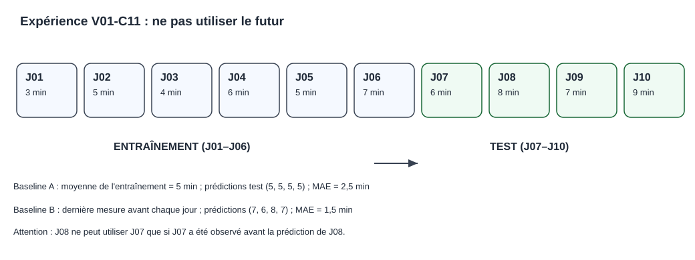

# Chapitre 11 — Concevoir une première expérimentation mesurable

> **DRAFT — cours original.** Les données ci-dessous sont entièrement synthétiques ; aucune performance professionnelle n'est revendiquée.

> **Rôle de ce chapitre — preuve expérimentale élémentaire.** On compare deux baselines prévisionnelles sur des données fictives, sans en déduire un gain métier. Le [C04](04-statistical-learning.qmd) définit les métriques ; le [C12](12-capstone-and-exercises.qmd) inclut les critères d'acceptation dans un dossier complet.

## 1. Objectifs

Formuler une hypothèse testable, construire une baseline, définir un découpage temporel correct, calculer une métrique, proposer des tests négatifs et rédiger un rapport qui distingue résultats attendus, résultats observés et limites.

## 2. Un POC commence par une question

« Déployer une IA » n'est pas une question expérimentale. « Prédire la durée de traitement du prochain dossier mieux qu'une méthode de référence, selon un protocole identique » est une hypothèse vérifiable.

Avant de commencer, définir :
- les utilisateurs et la décision à éclairer ;
- les données disponibles à l'instant de prédiction ;
- la population cible, la période et les cas exclus ;
- les alternatives simples sans IA complexe ;
- les métriques et seuils d'acceptation approuvés ;
- les conséquences des erreurs ;
- la reproductibilité des données et de l'exécution.

L'objectif doit être approuvé avant de regarder les résultats. Sinon l'équipe risque de reformuler les critères jusqu'à donner artificiellement l'impression de réussir.

*Figure pédagogique originale : la méthode de persistance est évaluée à un pas ; les valeurs futures ne sont pas accessibles à l'instant de prédiction.*

## 3. Notre dataset synthétique

Nous créons dix observations fictives ordonnées par jour :

| Jour | Durée réelle en minutes |
|---|---:|
| J01 | 3 |
| J02 | 5 |
| J03 | 4 |
| J04 | 6 |
| J05 | 5 |
| J06 | 7 |
| J07 | 6 |
| J08 | 8 |
| J09 | 7 |
| J10 | 9 |

Les six premières observations forment la période d'entraînement et les quatre dernières servent à l'évaluation. Un jeu si court n'est pas adapté à un benchmark industriel : nous l'utilisons pour rendre chaque calcul transparent.

Dans un vrai projet, un protocole devrait également prévoir une phase de validation pour choisir les méthodes, une taille représentative et des mesures d'incertitude.

## 4. Baseline A : moyenne historique

La moyenne de l'entraînement vaut :

$$
\overline{y}=\frac{3+5+4+6+5+7}{6}=5.
$$

La méthode A prédit donc 5 minutes pour chacun des quatre cas futurs. Les durées réelles sont 6, 8, 7 et 9 minutes. Les erreurs absolues sont respectivement 1, 3, 2, 4.

L'erreur absolue moyenne vaut :

$$
MAE_A=\frac{1+3+2+4}{4}=2{,}5\ \mathrm{min}.
$$

Une MAE de 2,5 minutes n'est ni bonne ni mauvaise sans objectif métier : une erreur de 2 minutes pourrait être négligeable pour certains usages et inacceptable pour d'autres.

## 5. Baseline B : dernière observation disponible

Nous proposons une deuxième méthode appelée persistance : pour prédire la durée du prochain jour, utiliser la dernière durée observée.

Dans une évaluation **pas à pas**, la série de prédictions J07 à J10 est :

| Jour prédit | Valeur précédente accessible | Prédiction | Durée réelle | Erreur absolue |
|---|---:|---:|---:|---:|
| J07 | J06 = 7 | 7 | 6 | 1 |
| J08 | J07 = 6 | 6 | 8 | 2 |
| J09 | J08 = 8 | 8 | 7 | 1 |
| J10 | J09 = 7 | 7 | 9 | 2 |

$$
MAE_B=\frac{1+2+1+2}{4}=1{,}5\ \mathrm{min}.
$$

Le mot **accessible** est indispensable. Si le modèle doit produire quatre prédictions au soir de J06, il ne peut pas connaître J07, J08 et J09. Ici nous évaluons une prévision **à un seul pas**, effectuée à chaque nouveau jour après la réception de l'observation précédente.

Comparer les deux méthodes avec un autre protocole pourrait changer le résultat. L'architecture des données doit donc décrire la fréquence de collecte et la disponibilité des informations.

## 6. Exprimer le résultat sans lui faire dire trop

La baisse absolue de MAE entre A et B vaut :

$$
2{,}5-1{,}5=1{,}0\ \mathrm{min}.
$$

La baisse relative vaut :

$$
\frac{2{,}5-1{,}5}{2{,}5}=40\,\%.
$$

La conclusion autorisée est : **sur ces quatre observations synthétiques, selon le protocole à un pas, la MAE de la baseline B est inférieure de 40 % à celle de A**.

Cette expérience ne démontre pas :
- une réduction de 40 % du temps réel de traitement ;
- un bénéfice financier de 40 % ;
- une généralisation à une population future ;
- le respect d'un SLO de production ;
- le fonctionnement d'un service IA sur GPU.

Une bonne preuve inclut autant les limites que les chiffres.

## 7. Baselines, paramètres et sélection

Une baseline représente un point de comparaison. Elle peut être simple et déterministe : dernière valeur, moyenne, règle de seuil ou recherche classique.

Un modèle plus complexe n'est justifié que s'il améliore suffisamment les critères de décision pour compenser ses coûts et risques. Les paramètres peuvent être ajustés sur l'entraînement ; les hyperparamètres sont comparés sur la validation.

Il faut préserver un **test indépendant**. Si l'équipe modifie le modèle après chaque consultation des résultats du jeu de test, celui-ci finit par influencer indirectement la sélection et perd sa valeur d'évaluation finale.

Pour les séries temporelles, le découpage chronologique doit empêcher une information future de se retrouver dans une prédiction du passé.

## 8. Laboratoire Python reproductible

Le lab proposé se trouve dans [LAB V01 — évaluation de deux baselines](../../../labs/v01-experiment/README.md). Il utilise Python standard, sans GPU, sans comptes cloud et sans information client.

Depuis la racine du Masterbook :

~~~bash
python -m unittest discover -s labs/v01-experiment -p 'test_*.py' -v
python labs/v01-experiment/experiment.py
~~~

Le laboratoire doit fournir la séparation temporelle, les deux MAE, les prédictions de chaque méthode et les tests d'entrées invalides.

**La présence de commandes n'est pas une preuve de leur exécution.** Les résultats seront considérés comme observés uniquement après un test documenté avec les fichiers et versions exacts.

## 9. Tests positifs, négatifs et qualité des preuves

Un test positif vérifie un cas attendu. Un test négatif vérifie qu'une entrée invalide ou un scénario interdit est correctement refusé.

Pour notre expérience, contrôler au minimum :

1. la moyenne des six premières valeurs vaut 5 ;
2. les prédictions A valent toujours 5 ;
3. les prédictions B n'utilisent que la dernière observation disponible ;
4. les MAE calculées valent 2,5 et 1,5 ;
5. une liste vide est rejetée ;
6. des longueurs de séries différentes sont rejetées ;
7. une valeur non finie est rejetée ;
8. le découpage entraînement/test respecte l'ordre déclaré.

Dans une application à enjeux élevés, des tests supplémentaires sont nécessaires : protection des données, droits des utilisateurs, cas rares, indisponibilité d'un service et restauration après incident.

## 10. Rapport de preuve minimal

| Champ | Valeur |
|---|---|
| Tâche | Prédire une durée, en minutes |
| Dataset | Série fictive J01–J10 versionnée |
| Historique | J01–J06 |
| Test | J07–J10 |
| Baseline A | Moyenne fixe calculée sur historique |
| Baseline B | Persistance, prédiction à un pas |
| Métrique | MAE en minutes |
| Résultats calculés manuellement | A = 2,5 ; B = 1,5 |
| Mesure de coûts | Non réalisée pour ce cours |
| Exécution logicielle | À consigner séparément après passage des tests |
| Limites | Jeu minuscule, entièrement synthétique |

Une preuve runtime doit identifier l'environnement, la commande, la version du code et ses résultats réels. Le même formalisme sera repris dans les volumes de MLOps et d'évaluation.

## 11. Pourquoi le protocole se complique avec les LLM

Un système génératif produit souvent des réponses dont la correction exige plusieurs contrôles : exactitude des faits, fidélité aux sources, refus d'information interdite, utilité et robustesse.

Un corpus d'évaluation peut inclure :
- questions simples avec réponse vérifiable ;
- documents contradictoires ;
- questions sans source ;
- documents non autorisés ;
- instructions hostiles injectées dans des données ;
- requêtes longues, simultanées ou répétées.

Chaque cas a une attente définie. Un évaluateur humain peut intervenir lorsque l'exactitude ne peut être résumée à une égalité simple, mais les propriétés de permissions doivent rester contrôlées par des tests techniques.

## 12. Coût, temps et consommation

Un modèle peut réduire l'erreur tout en multipliant le temps de calcul et le coût. Le protocole doit donc prévoir, si ces critères sont pertinents, des mesures de latence, de débit, de mémoire, d'énergie et de coût par résultat valide.

Un résultat de benchmark emprunté à une autre machine n'est pas automatiquement transposable à l'environnement du projet. Le CPU, le GPU, les versions, le batch et les entrées réelles peuvent changer les performances.

Notre premier lab utilise des calculs élémentaires sur CPU : il prépare la méthode de mesure, pas un comparatif matériel.

## 13. Exercices corrigés

**A.** Un prédicteur annonce 4 minutes pour trois durées réelles 2, 6 et 4. Calculer la MAE.

*Correction.* Erreurs 2, 2 et 0 ; MAE = 4/3, environ 1,33 minute.

**B.** Une équipe optimise son modèle après consultation répétée du test. Pourquoi le protocole est-il affaibli ?

*Correction.* Le test a influencé le choix du modèle ; il faut préserver une mesure indépendante.

**C.** La MAE baisse de 2 à 1. Peut-on dire que l'entreprise traite deux fois plus vite ses dossiers ?

*Correction.* Non. Une erreur de prévision n'est pas une durée réellement économisée.

**D.** Une méthode prédit une période future en utilisant la durée déjà mesurée de cette période. Qu'a-t-elle introduit ?

*Correction.* Une fuite temporelle. Les données futures ne sont pas disponibles à l'instant de prévision.

**E.** Un modèle a une excellente moyenne sur les cas ordinaires mais échoue sur tous les cas critiques. Est-il prêt ?

*Correction.* Non. Les risques, sous-populations et critères éliminatoires sont à évaluer séparément.

## 14. Atelier supplémentaire — incertitude et qualité d'un benchmark

### Ce que notre résultat ne mesure pas

La diminution de MAE de 2,5 à 1,5 minute est correcte pour les quatre observations synthétiques utilisées. Elle ne dit rien sur sa stabilité dans une population plus large. Une comparaison crédible doit prendre en compte :

- la diversité des périodes et des activités ;
- le nombre de cas et leur indépendance ;
- les données manquantes et les erreurs de mesure ;
- les changements de comportement ou de politique ;
- les coûts de calcul et de maintenance ;
- les sous-populations où la méthode échoue.

Le protocole de prévision **à un pas** est un choix explicite. Si l'équipe doit produire toutes les prédictions en avance, il faudra repenser la baseline B : utiliser des observations futures reviendrait à introduire une fuite de données.

### Répéter l'expérience sans changer ses règles

Dans un système réel, une évaluation temporelle peut répéter le protocole sur plusieurs fenêtres : entraîner ou recalibrer sur une période antérieure et tester sur une période ultérieure. Cette famille d'approches est parfois nommée *rolling-origin evaluation* ou validation à origine glissante, avec des variantes qu'il faut préciser.

Pour comparer correctement, chaque fenêtre doit respecter l'instant où les données sont disponibles et conserver les mêmes définitions de métriques. Les résultats peuvent être présentés séparément, puis agrégés si l'agrégation est justifiée.

Une moyenne d'erreurs sur plusieurs fenêtres ne dispense pas de montrer les **périodes dégradées** ou les erreurs extrêmes importantes pour le métier.

### Construire un rapport interprétable

| Affirmation | Statut du chapitre |
|---|---|
| Les données du cours sont synthétiques | Établi par construction |
| Les calculs manuels de MAE valent 2,5 et 1,5 | Vérifiés pour le tableau |
| La baseline B gagne sur les quatre jours de test | Vrai pour cet échantillon |
| Le gain se maintient sur un service réel | Non établi |
| Les coûts cloud/GPU sont économiquement acceptables | Non mesurés |
| Le laboratoire s'exécute sans erreur en CI GitHub | À revérifier sur runner |

### Exercice

Deux modèles ont la même MAE globale. L'un sous-estime fortement les cas rares les plus coûteux, l'autre répartit ses erreurs de façon plus régulière. Peut-on les déclarer équivalents ?

**Correction.** Non. La MAE agrégée masque les conséquences et la distribution des erreurs. Il faut examiner les sous-populations, les percentiles ou d'autres critères appropriés, puis relier les résultats à la décision métier.

Pour le mini-projet documentaire du [chapitre 12](12-capstone-and-exercises.qmd), les critères de refus d'accès sont éliminatoires : aucune moyenne de qualité ne peut les compenser.

## 15. Atelier approfondi — validation à un pas et prévision multi-horizon

Le laboratoire a montré une prédiction à un pas où l'observation du jour J est disponible **avant** la prédiction du jour J+1. Ce protocole ne convient pas à tous les besoins. Une direction d'exploitation peut demander le lundi matin les estimations des quatre prochains jours, alors qu'aucun de ces résultats n'est connu : il s'agit d'un problème de prévision **multi-horizon**.

| Protocole | Information admise | Produit |
|---|---|---|
| Un pas | Observations connues jusqu'au jour précédent | Prochain jour |
| Plusieurs pas en une fois | Historique connu à la date de coupure | Ensemble des jours futurs |

Le même modèle peut être performant dans un cas et non dans l'autre. La différence provient de la **disponibilité réelle des observations**, et non du nom donné à l'algorithme.

### Calculer sans regarder le futur

Au soir de J06, la dernière durée accessible est 7 minutes. Pour prédire d'un seul coup J07–J10 par simple persistance, nous devons annoncer les valeurs \((7,7,7,7)\), car les observations des jours J07, J08 et J09 n'ont pas encore eu lieu.

Les valeurs réelles ultérieures sont \((6,8,7,9)\). Les erreurs absolues sont \((1,1,0,2)\), d'où :

\[
MAE_{\text{multi-horizon}}=\frac{1+1+0+2}{4}=1\ \mathrm{minute}.
\]

La méthode à un pas du cours avait une MAE de 1,5 minute. Il serait incorrect d'en conclure que la prévision multi-horizon est **toujours** supérieure : l'exemple de quatre cas fictifs est beaucoup trop petit, et le résultat dépend de la forme particulière de la série.

Pour un véritable benchmark, l'équipe doit garder la date de coupure visible, publier les performances **par horizon** et ne jamais utiliser une valeur future pour composer une entrée passée.

### Fiche de disponibilité des variables

| Variable candidate | Moment de disponibilité | Risque |
|---|---|---|
| Catégorie initiale d'un ticket | Création | Erreur de saisie |
| Priorité initiale | Création | Modification ultérieure possible |
| Durée finale de résolution | Clôture | Cible, donc interdite à la création |
| Nombre final de transferts | Clôture | Fuite d'information future |
| Dernière note de résolution | Clôture | Fuite temporelle et texte sensible |
| Tickets ouverts à l'instant T | T, sous réserve de disponibilité | Cohérence temporelle et calcul |

Un modèle qui prédit très bien une clôture grâce à la **date de clôture** n'a pas accompli une prouesse : il a vu une information qui devrait lui être interdite au moment de l'estimation.

### Validation à plusieurs fenêtres

Sur un historique significatif, on peut répéter l'expérience à plusieurs dates de coupure. Chaque fenêtre sépare les périodes d'ajustement, de choix éventuel d'hyperparamètres et d'évaluation. Les métriques doivent être calculées de façon identique et conservées **par fenêtre**, même lorsque le résultat global est présenté.

Un modèle peut gagner dans une période et perdre dans une autre. Cette observation ne prouve pas nécessairement une erreur de code. Les données, populations et processus peuvent avoir changé ; il faut analyser les régimes, la saisonnalité et les cas extrêmes.

### Exercices et corrigés

**A.** Pourquoi la dernière valeur réelle de J07 ne peut-elle pas servir à prédire J08 le soir de J06 ? Parce que J07 est encore dans le futur à cette date.

**B.** Un algorithme gagne sur quatre jours et perd sur les quatre suivants. Que faut-il présenter ? Les résultats par fenêtre, les distributions d'erreur, les conditions du changement et l'incertitude, pas seulement une moyenne.

**C.** Un modèle diminue la MAE mais surestime les urgences critiques. Peut-il être retenu sur sa moyenne ? Non : les erreurs et conséquences critiques doivent être analysées séparément.

**D.** Pourquoi garder la dernière valeur observée comme baseline ? Pour mesurer si un modèle plus sophistiqué produit un gain sur une méthode minimale qu'il est honnête d'essayer de battre.

## 16. Rédiger la conclusion exacte d'un POC

Trois formulations se ressemblent mais ne disent pas la même chose.

**Incorrect :** « Notre IA accroît la productivité de 40 %. » L'expérience ne mesure aucun temps de travail réellement économisé.

**Insuffisant :** « Le modèle améliore la qualité de 40 %. » Le modèle, la métrique et le protocole ne sont pas définis.

**Correct dans ce cadre :** « Sur quatre observations synthétiques de prévision à un pas, la baseline de dernière valeur obtient une MAE de 1,5 minute contre 2,5 minutes pour la moyenne historique fixe, soit une réduction relative de 40 % de cette erreur particulière. Ce résultat ne démontre aucun gain métier. »

Une conclusion exploitable conserve date, version du code, définition de la tâche, séparation temporelle, nombre de cas, métrique, valeurs observées et limitations. Sans ces informations, on ne pourra ni vérifier ni comparer l'essai.

## 17. Comparer les erreurs sur les mêmes observations

Une amélioration moyenne ne suffit pas à raconter l'histoire d'une expérience. Pour juger de deux prévisions, nous devons aussi observer **les erreurs des deux méthodes sur chaque même cas**.

Reprenons les quatre journées synthétiques du laboratoire :

| Jour | Erreur absolue A | Erreur absolue B | Différence A − B |
|---|---:|---:|---:|
| J07 | 1 | 1 | 0 |
| J08 | 3 | 2 | 1 |
| J09 | 2 | 1 | 1 |
| J10 | 4 | 2 | 2 |
| **Moyenne** | **2,5** | **1,5** | **1,0** |

La différence moyenne appariée vaut :

\[
\overline{d}=\frac{0+1+1+2}{4}=1\ \text{minute}.
\]

Elle correspond à la différence des MAE calculées sur les mêmes observations, soit 2,5 − 1,5 = 1 minute.

### Ce que la comparaison appariée apporte

Chaque journée sert de référence commune aux deux méthodes. Nous ne comparons donc pas le modèle A sur quatre jours faciles à B sur quatre jours difficiles. La comparaison devient plus juste, mais n'élimine pas toutes les incertitudes.

En particulier, **quatre observations ne suffisent pas** à démontrer une amélioration générale. Les journées successives peuvent dépendre d'un même incident, d'une saison ou d'une évolution du processus. On ne doit pas les considérer automatiquement comme des tirages statistiquement indépendants.

Sur un corpus important, on peut estimer l'incertitude de la différence avec une méthode adaptée au protocole, en tenant compte de la dépendance temporelle. Un rééchantillonnage naïf de journées indépendantes n'est pas toujours approprié.

### Les erreurs extrêmes ont une importance propre

Considérons une méthode C dont les erreurs absolues valent (0, 0, 0, 6). Sa MAE vaut elle aussi 1,5 minute : elle est égale à celle de B. Pourtant, C présente un cas d'erreur beaucoup plus élevé.

**Exercice corrigé.** Peut-on déclarer B et C équivalentes pour la planification d'une urgence ?

**Réponse.** Non. L'égalité des moyennes ne décrit pas les cas extrêmes, les sous-populations ou le coût des erreurs. L'équipe doit mesurer les scénarios pertinents et les conséquences métier.

## 18. Concevoir un protocole d'expérience qui résiste à la répétition

Une expérience devient peu convaincante lorsque ses règles sont changées **après** la lecture des résultats. Par exemple, une équipe pourrait choisir un jeu de test, constater une défaite de son modèle, modifier ses règles, relancer le test et répéter l'opération jusqu'à obtenir un meilleur score.

Même sans apprentissage automatique explicite, ces retouches adaptent indirectement la solution au jeu de test. Le résultat final risque de surestimer sa qualité sur des cas nouveaux.

### Quatre ensembles ayant des usages distincts

Pour un projet suffisamment riche en données, définir :

1. **Jeu de développement** : vérifier les formats, les cas de base et les fonctions.
2. **Entraînement** : ajuster les paramètres des modèles apprenants.
3. **Validation** : choisir les variantes et les hyperparamètres.
4. **Test final** : évaluer la variante retenue après avoir fixé le protocole.

Dans notre laboratoire sur dix observations, les effectifs ne permettent pas une validation scientifique robuste sur quatre ensembles. Nous avons seulement construit **un exercice transparent**, dont on connaît les limites.

### Définir une fiche de cas

Une équipe pourrait consigner les informations suivantes :

| Champ | Fonction |
|---|---|
| Identifiant synthétique | Retrouver le cas sans inclure de donnée client |
| Instant de prédiction | Déterminer les entrées disponibles |
| Version des variables | Identifier le schéma et les transformations |
| Cible de référence | Définir la valeur utilisée pour juger la prédiction |
| Prédiction baseline | Conserver la sortie de référence |
| Prédiction candidate | Conserver la sortie de la méthode étudiée |
| Version de métrique | Reproduire le calcul |
| Verdict | Appliquer un critère connu avant le test |

Si une variable, la définition de la cible ou une méthode de normalisation change, cette modification doit être traçable. Sans versionnement des transformations, deux résultats ayant la même étiquette de métrique peuvent être incomparables.

### Un essai de LLM demande des tests négatifs

Un assistant documentaire peut réussir toutes les questions dont les réponses figurent dans les sources, mais échouer sur une demande hors permission, une procédure périmée ou une question sans réponse.

Pour cette raison, un corpus de validation doit contenir des **cas qui exigent une abstention ou un refus**, et le modèle ne doit pas être jugé uniquement sur des réponses détaillées et agréables à lire. Les propriétés de sécurité essentielles doivent rester des critères éliminatoires contrôlés côté application.

### Exercice corrigé

Une équipe annonce 100 % de réussite après avoir adapté son assistant jusqu'à répondre parfaitement à ses vingt questions connues. Son taux prouve-t-il qu'elle est prête pour la production ?

**Réponse.** Non. Il décrit les vingt questions sur lesquelles la solution a été adaptée. Il faut un jeu indépendant, des scénarios de refus et d'erreur, des NFR chiffrés et des observations de fonctionnement selon l'environnement cible.

## 19. Synthèse

Le POC utile part d'un besoin mesurable et produit une **preuve bornée**. Il compare un système simple à une option plus complexe dans des conditions loyales et ne transforme jamais une observation sur quelques exemples en certitude industrielle.

Le chapitre 12 réunit ces réflexes dans un mini-projet d'architecture.

**Lecture complémentaire :** [scikit-learn — validation croisée et découpage des séries temporelles](https://scikit-learn.org/stable/modules/cross_validation.html#time-series-split). Cette ressource illustre pourquoi un mélange aléatoire de périodes peut produire une estimation trompeuse de la généralisation temporelle.
